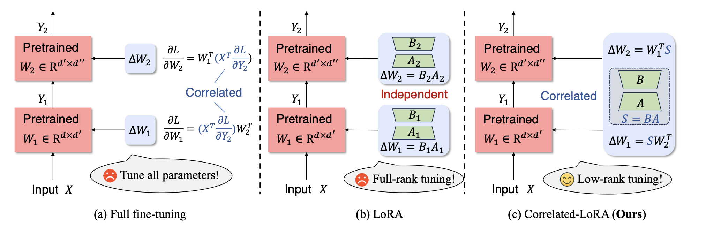
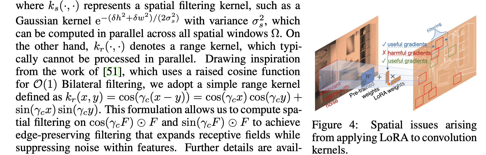
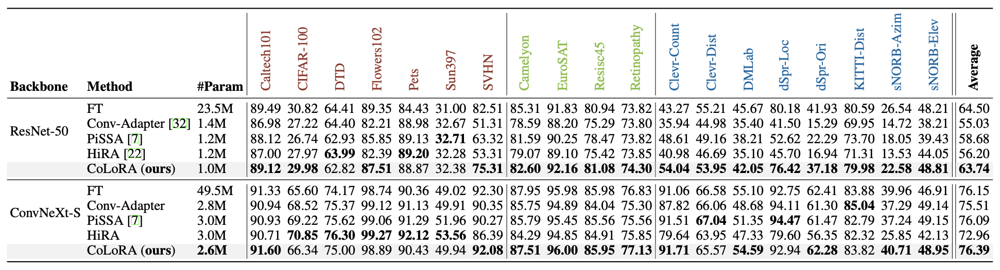
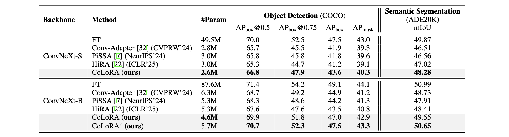

# CoLoRA
This is the code implementation for the CoLoRA (NeurIPS 2025).
> Low-Rank Adaptation (LoRA) methods have demonstrated considerable success in achieving parameter-efficient fine-tuning (PEFT) for Transformer-based foundation models. These methods typically fine-tune individual Transformer layers using independent LoRA adaptations. However, directly applying existing LoRA techniques to convolutional networks (ConvNets) yields unsatisfactory results due to the high correlation between the stacked sequential layers of ConvNets. To overcome this challenge, we introduce a novel framework called **Co**rrelated **Lo**w-**R**ank **A**daptation (CoLoRA), which explicitly utilizes correlated low-rank matrices to model the inter-layer dependencies among convolutional layers. Additionally, to enhance tuning efficiency, we propose a parameter-free filtering method that enlarges the receptive field of LoRA, thus minimizing interference from non-informative local regions. Comprehensive experiments conducted across various mainstream vision tasks, including image classification, semantic segmentation, and object detection, illustrate that CoLoRA significantly advances the state-of-the-art PEFT approaches. Notably, our CoLoRA achieves superior performance with only 5% of trainable parameters, surpassing full fine-tuning in the image classification task on the VTAB-1k dataset using ConvNeXt-S. 

## Build environment
> Since this work contains **classification**, **semantic segmentation** and **object detection**, we provide a detail guide to build environment. Following these instructions:

```
# install torch
pip install torch==1.12.1+cu113 torchvision==0.13.1+cu113 torchaudio==0.12.1 --extra-index-url https://download.pytorch.org/whl/cu113
# install tap
pip install typed-argument-parser
# install openmim, mmclassification, mmdet, and mmsegmentation
pip install -U openmim
mim install mmcv-full==1.7.0
mim install mmsegmentation==0.30.0
mim install mmdet==2.28.2 
mim install mmcls==0.25.0
# install nvidia apex (download the official repo for apex and use the official command to install. If any error, try the below command)
pip install -v --no-cache-dir --no-build-isolation --global-option="--cpp_ext" --global-option="--cuda_ext" --global-option="--deprecated_fused_adam" --global-option="--xentropy" --global-option="--fast_multihead_attn" ./
# install timm
pip install timm --no-deps
# fix possible data time error in mmcv
sudo vim /opt/conda/lib/python3.7/site-packages/mmcv/runner/hooks/logger/text.py (line 153 )
# enabling half-precision for mmcv
sudo vim /opt/conda/lib/python3.7/site-packages/apex/normalization/fused_layer_norm.py (line 18, force return False due to imcompatability between torch1.12 and apex ops)
```

## Methods
- CoLoRA overview: We consider the correlation between adjacent convolutional layers and model them with correlated low-rank matrices.
- LoRA filtering: We propose a parameter-free filtering method to enlarge the receptive field of LoRA, thus minimizing interference from non-informative local regions.



## USAGE
> Please refer to the `classification`, `semantic segmentation`, and `object detection` folders for the usage of CoLoRA on FGVC classification, semantic segmentation, and object detection tasks, respectively.

## Main Results
- Comparision on FGVC classification task on VTAB-1k dataset.


- Comparision on ADE20K and COCO datasets.


We thank the following repositories for their helpful codebase:
- [ConvNeXt official](https://github.com/facebookresearch/ConvNeXt/tree/main/semantic_segmentation/configs/convnext)
- [mmsegmentation](https://github.com/open-mmlab/mmsegmentation)
- [mmdetection](https://github.com/open-mmlab/mmdetection)
- [ConvAdapter](https://github.com/Hhhhhhao/Conv-Adapter)
- [PiSSA](https://github.com/GraphPKU/PiSSA)

If this repository is helpful to your work, please consider citing this paper:
```
@inproceedings{rancorrelated,
  title={Correlated Low-Rank Adaptation for ConvNets},
  author={Ran, Wu and Zhang, Weijia and Pang, ShuYang and Zhu, Qi and Liu, Jinfan and Liu, JingSheng and Cao, Xin and Li, Qiang and Yan, Yichao and Ma, Chao},
  booktitle={The Thirty-ninth Annual Conference on Neural Information Processing Systems},
  year={2025}
}
``` 