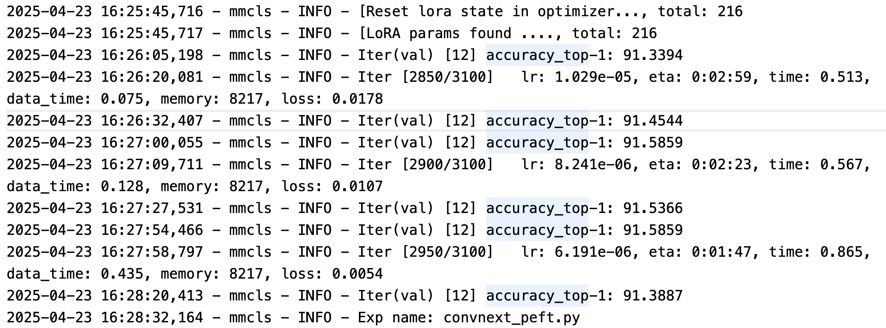

# FGVC Classification on VTAB-1k
> This repository contains the code implementation for the CoLoRA (NeurIPS 2025) on FGVC classification task on VTAB-1k dataset. The hyper-parameters for ConvNeXt families are adatpted from [ConvNeXt official](https://github.com/facebookresearch/ConvNeXt/tree/main/semantic_segmentation/configs/convnext)

## Requirements
- Python 3.7+
- PyTorch 1.12.1+cu113
- mmcv-full==1.7.0
- mmcls=0.25.0
- apex

## Training command
**Training convnext-b with CoLoRA**
```
# train convnext-s with CoLoRA
bash tools/train_convnext.sh
```
**Training models with other PEFT techniques**: configure the `configs/mae/convnext_peft.py` or `configs/mae/res50_colora.py` files, and modify the backbone type from `ConvNeXtCoLoRA` to `ConvNeXtConvAdapter`, `ConvNeXtHIRA`, `ConvNeXtPiSSA` (Please adapt the backbone type accordingly for ResNet backbone).  Modify the `lora_reduction` parameter carefully for different LoRA methods.

## Evaluation
The results presented in the paper is collected from the training logs.
`ConvNeXt-S (CoLoRA)` on subset `Caltech101`


