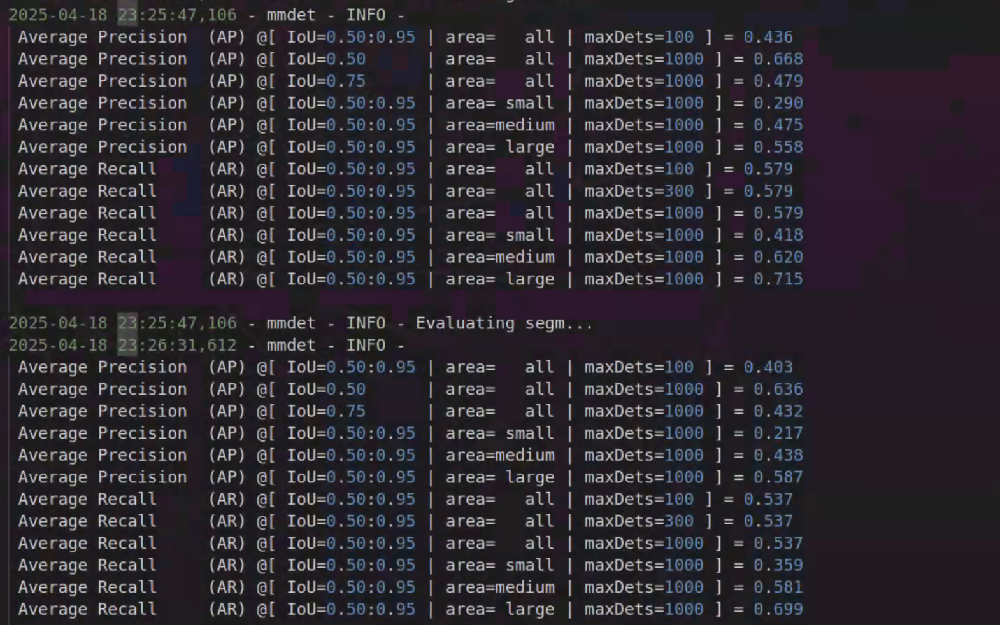

# Object Detection
> This repository contains the code implementation for the CoLoRA (NeurIPS 2025) on MSCOCO object detection task. The hyper-parameters for ConvNeXt families are adatpted from [ConvNeXt official](https://github.com/facebookresearch/ConvNeXt/tree/main/object_detection/configs/convnext)

## Requirements
- Python 3.7+
- PyTorch 1.12.1+cu113
- mmcv-full==1.7.0
- mmdet==2.28.2
- apex

## Training command
**Training convnext-b with CoLoRA**
```
# train convnext-b with CoLoRA
bash tools/dist_train.sh configs/convnext_peft.py 4
```
**Training convnext-b with other PEFT techniques**: configure the `configs/convnext/convnext_peft.py` file, and modify the backbone type from `ConvNeXtCoLoRA` to `ConvNeXtConvAdapter`, `ConvNeXtHIRA`, `ConvNeXtPiSSA`. Modify the `lora_reduction` parameter carefully for different LoRA methods.

## Evaluation
The results presented in the paper is collected from the training logs.

