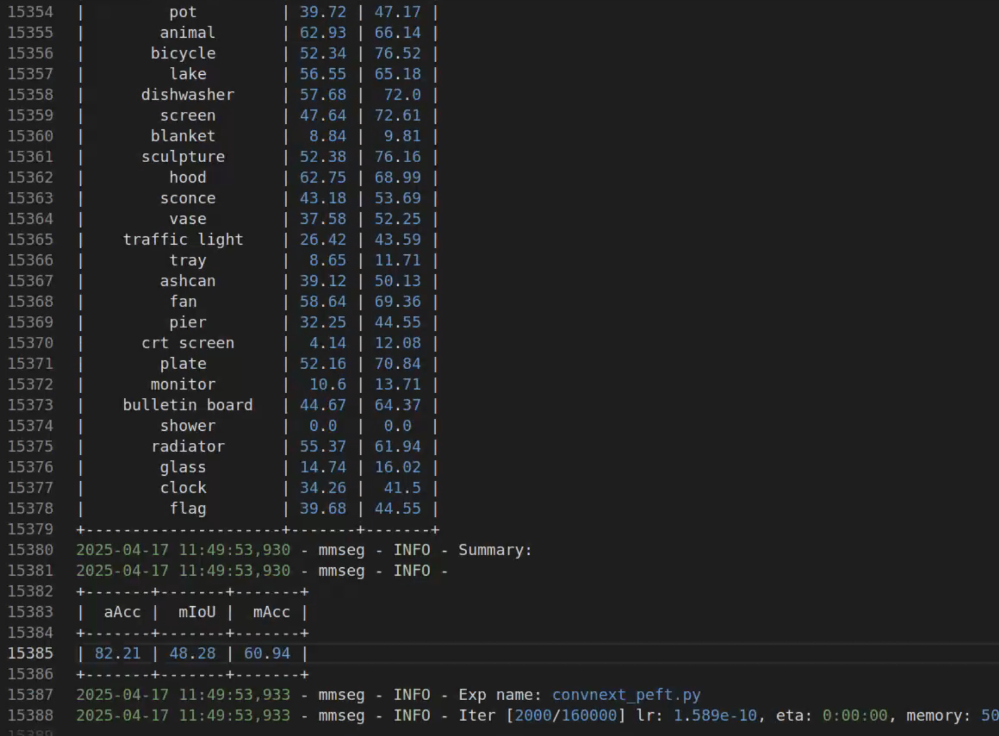

# Segmentation
> This repository contains the code implementation for the CoLoRA (NeurIPS 2025) on segmentation task. The hyper-parameters for ConvNeXt families are adatpted from [ConvNeXt official](https://github.com/facebookresearch/ConvNeXt/tree/main/semantic_segmentation/configs/convnext)

## Requirements
- Python 3.7+
- PyTorch 1.12.1+cu113
- mmcv-full==1.7.0
- mmsegmentation==0.30.0
- apex

## Training command
** Training convnext-b with CoLoRA **
```
# train convnext-b with CoLoRA
bash tools/train_convnext.sh
```
** Training convnext-b with other PEFT techniques **: configure the `configs/mae/convnext_b_peft.py` file, and modify the backbone type from `ConvNeXtCoLoRA` to `ConvNeXtConvAdapter`, `ConvNeXtHIRA`, `ConvNeXtPiSSA`.

## Evaluation
The results presented in the paper is collected from the training logs.

** Evaluation convnext-b with PEFT techniques **
```
# evaluate convnext-b with CoLoRA
bash tools/eval_convnext.sh
```
